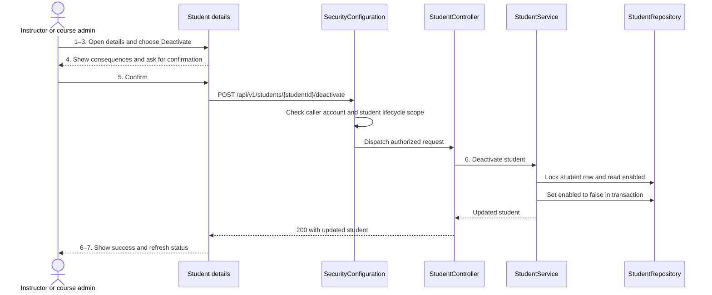

# Student administration

**Realizes** [UC-STU-deactivate-student](../requirements/use-cases.md#uc-stu-deactivate-student-the-course-admininstructor-deactivates-a-student).

**Depends on** FR-SEC-active-account, FR-SEC-authorization and FR-NOT-weekly-reminder in the [SRS](../requirements/software-requirements-specification.md), and BR-student-lifecycle, BR-inactive-evaluatee and BR-submission-owed in [Business Rules](../requirements/business-rules.md).

## Overview

The existing SPA and REST API slices follow the [architecture of record](architectural-design.md). The [SRS domain model](../requirements/software-requirements-specification.md#business-domain-model) supplies the existing account flag, course section, team and submission relationships. The design adds no schema or Level 1 component changes.

## Components

| Component | Design |
| --- | --- |
| [EditStudentForm.vue](../../frontend/src/pages/students/EditStudentForm.vue) and [student API client](../../frontend/src/apis/student/index.ts) | Extend the student details dialog with a confirmed deactivation action. Update the dialog and refresh the student table on success. |
| [StudentController](../../backend/src/main/java/team/projectpulse/student/StudentController.java), [StudentService](../../backend/src/main/java/team/projectpulse/student/StudentService.java), [StudentRepository](../../backend/src/main/java/team/projectpulse/student/StudentRepository.java) | Add a dedicated controller action and transactional service method. Reuse the student DTO and persisted account flag. Serialize deactivation and profile edits on the student row. |
| [SecurityConfiguration](../../backend/src/main/java/team/projectpulse/security/SecurityConfiguration.java) and [StudentSecurityService](../../backend/src/main/java/team/projectpulse/student/StudentSecurityService.java) | Add a student lifecycle authorization manager for the course owner or assigned instructor, without granting student-self access to the new action. Reuse this scope for reading the target's details alongside the existing self-access rule. Add an account-status JWT validator that looks up the signed user ID in the existing user repository and composes with normal token validation. |
| [SubmitTeamsEvaluations.vue](../../frontend/src/pages/evaluations/SubmitTeamsEvaluations.vue) and [EvaluationService](../../backend/src/main/java/team/projectpulse/evaluation/EvaluationService.java) | Filter inactive targets when creating new evaluation rows. The service checks eligibility on create and builds the section report from active team members plus inactive team members with received evaluations for the requested week. |
| [SubmissionStatusService](../../backend/src/main/java/team/projectpulse/notification/SubmissionStatusService.java) | Reuse the existing BR-submission-owed filter and reminder path. |

## Confirmation sequence

## API contract

All paths below are under `/api/v1` and use the existing response envelope.

| Method and path | Caller and input | Result |
| --- | --- | --- |
| POST `/students/{studentId}/deactivate` | Course owner or instructor assigned to the target's section. Path ID only. | 200 with updated student. 401 for unauthenticated or inactive caller. 403 for a caller outside scope or unknown target. 409 for an authorized repeat request. |
| GET `/students/{studentId}` | Existing student-self access, assigned instructor, or owner of the student's course. Path ID only. | Existing student details or scope denial. |
| PUT `/students/{studentId}` | Existing profile callers. Existing profile DTO, with an optional explicit `reactivate=true` query flag for the legacy enable shortcut. | Existing profile response. Ordinary saves ignore the submitted status. The shortcut may only enable an inactive account when the caller has lifecycle scope and the request sets `enabled=true`. |
| POST `/evaluations` | Existing evaluator permissions and payload. | Existing success response. 400 when the target is inactive. |
| GET `/evaluations/sections/{sectionId}/week/{week}` | Existing report permission and path values. | Existing report shape with recipients selected under BR-inactive-evaluatee. |

The cancel path stays in the dialog and sends no request. The inactive status and in-flight confirmation state prevent duplicate clicks from the dialog. The API handles a stale confirmation independently.

## Decisions

- A dedicated transition separates deactivation from profile edits. Keeping a single status toggle on the generic edit would allow deactivation without the warning, and an old profile DTO with `enabled=true` could undo a recent deactivation. The explicit flag preserves the legacy enable shortcut without implementing the dedicated reactivation use case.
- Check persisted status on JWT validation. Waiting for token expiry would leave an already signed-in student with protected access. Use the stable signed user ID to avoid changes in the username breaking the lookup. This adds a database lookup to bearer requests.
- The lifecycle route checks the actual course owner or section assignment. The generic self-access rule would let a student call their own lifecycle endpoint.
- Leave team and submission links in place. Removing the student from the team would affect existing report lookups and require reassignment after reactivation. Scope eligibility to new evaluations and section report rows. Previously saved evaluations retain the existing edit window and remain visible in historical reports. A past week with zero received evaluations omits the inactive student.
- The evaluation form filters the roster locally so other consumers of the team roster continue to receive team membership. Reuse the stored evaluations when computing report inclusion and scores. The server still checks an inactive target when a stale evaluation form submits.

## Test list

| ID | Flow and level | Expected evidence |
| --- | --- | --- |
| STU-01 | Main success (API integration and UI) | An authorized instructor confirms, sees success, and the stored account is inactive. Section, team, weekly activity reports and existing peer evaluations are retained. |
| STU-02 | Reminders and outstanding ratings (service) | The inactive student owes neither item and an active teammate can complete their rating obligation without rating the inactive student. |
| STU-03 | Evaluation entry and stale form (UI and service) | New evaluation rows omit inactive targets. A direct create for an inactive target is rejected and writes no evaluation. |
| STU-04 | Section report (service) | An inactive student with a received evaluation appears with the stored result in that week. An inactive student with no evaluation for the requested week is absent. |
| STU-05 | Existing login (security integration) | A real token accepted before deactivation is rejected on the next protected request. |
| STU-06 | Already inactive (API integration) | A repeated confirmation returns 409 and leaves the account and associations intact. |
| STU-07 | Scope (security integration) | An unrelated instructor and the target student receive 403. The course owner can deactivate a student in a section they do not teach. |
| STU-08 | Warning cancellation (UI) | Cancel closes the warning, leaves details open, sends no request and shows the account still active. |
| STU-09 | Profile edit bypass (service or API integration) | An active student remains active on a profile update carrying `enabled=false`. An inactive student stays inactive on an ordinary or stale update carrying `enabled=true`. Explicit, authorized legacy re-enable remains available. |
